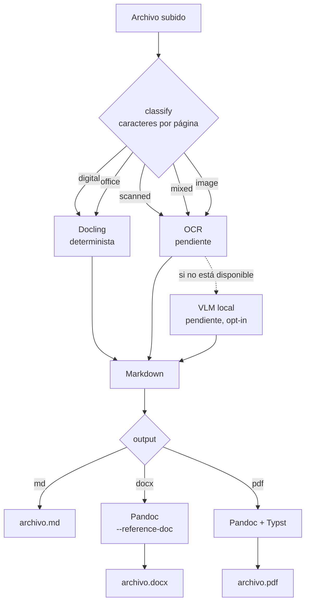

# files2md

Convierte PDFs, imágenes y documentos Office a **Markdown**, **Word** o **PDF** ordenado. **100% local**: tus
archivos no salen de tu máquina.

> Estado: en desarrollo. Ver [docs/ARCHITECTURE.md](docs/ARCHITECTURE.md) para qué está implementado y qué no.

## Cómo funciona

1. Clasifica la entrada: PDF digital, escaneado, mixto, imagen u Office.
2. Elige el motor: determinista (Docling) para documentos digitales; OCR o VLM para escaneados.
3. Exporta: Markdown directo, o Word/PDF vía Pandoc (con plantillas de estilo para Word).



Cada conversión registra qué motor se usó y cuánto tardó. Esos datos alimentan el [benchmark](benchmarks/README.md).
Los diagramas de componentes y del ciclo de vida de un job están en [docs/ARCHITECTURE.md](docs/ARCHITECTURE.md).

## Arranque rápido (Docker)

```bash
cp .env.example .env
docker compose --profile lite up --build      # PDFs digitales y Office -> Markdown
# docker compose --profile export up --build  # + exportar a Word/PDF (Pandoc)
# docker compose --profile full up --build    # + OCR para escaneados (pendiente)
```

Abre http://127.0.0.1:8000. El servicio solo escucha en `127.0.0.1` por defecto.

## Desarrollo sin Docker

```bash
cd backend
python -m venv .venv && source .venv/bin/activate
pip install -e ".[dev,parse]"
uvicorn app.main:app --reload
pytest
```

```bash
cd frontend
npm install
npm run dev                         # proxy a http://127.0.0.1:8000
```

## API

```bash
curl -F operation=parse.to_document -F 'params={"output":"md"}' -F files=@informe.pdf \
     http://127.0.0.1:8000/api/jobs                 # -> {"job_id": "..."}
curl http://127.0.0.1:8000/api/jobs/<job_id>        # estado, motor usado, outputs
curl -O http://127.0.0.1:8000/api/jobs/<job_id>/outputs/informe.md
```

## Seguridad

- Bind a `127.0.0.1` por defecto. Si lo expones a una red, define `FILES2MD_API_TOKEN` y ponlo detrás de un proxy con TLS.
- Límite de tamaño de subida y borrado automático por TTL.
- Sin telemetría. Los motores VLM o de API externa están apagados salvo que los actives.

## Proyecto hermano

[pdf-toolkit](https://github.com/) — combinar, reordenar y convertir PDFs e imágenes en el navegador.

## Licencia

[MIT](LICENSE). Ver `THIRD_PARTY_NOTICES.md` para las dependencias y sus licencias.
