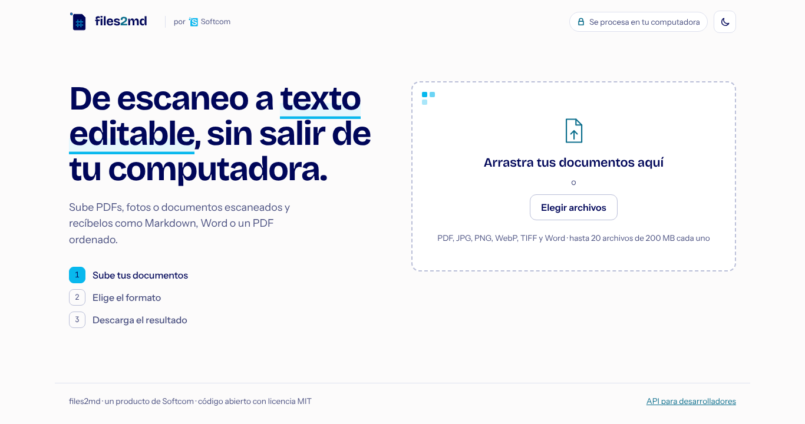
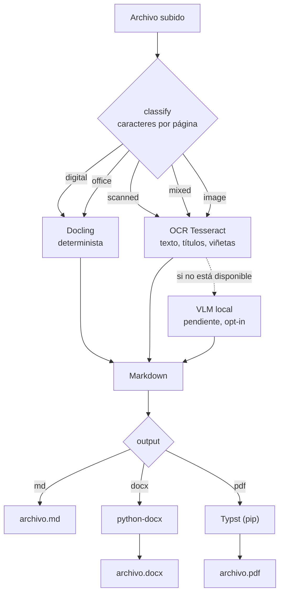

# files2md

Un producto de **[Softcom](https://softcom.com.pe)**. Desarrollado por Cesar Romero.

Convierte PDFs, imágenes y documentos Office a **Markdown**, **Word** o **PDF** ordenado. **100% local**: tus
archivos no salen de tu máquina.



> Estado: en desarrollo. Ver [docs/ARCHITECTURE.md](docs/ARCHITECTURE.md) para qué está implementado y qué no.

## Cómo funciona

1. Clasifica la entrada: PDF digital, escaneado, mixto, imagen u Office.
2. Elige el motor: determinista (Docling) para documentos digitales; OCR o VLM para escaneados.
3. Exporta: Markdown directo, o Word/PDF generados en Python (sin instalar programas aparte).



Cada conversión registra qué motor se usó y cuánto tardó. Esos datos alimentan el [benchmark](benchmarks/README.md).
Los diagramas de componentes y del ciclo de vida de un job están en [docs/ARCHITECTURE.md](docs/ARCHITECTURE.md).

## Uso en Windows con doble clic

Requisitos (una sola vez): [Python 3.11+](https://www.python.org/downloads/) y [Node.js LTS](https://nodejs.org/) y [Tesseract](#desarrollo-sin-docker) con el idioma español.

1. Doble clic en **`iniciar.bat`**.
2. La primera vez instala lo necesario (unos minutos). Las siguientes veces abre en segundos.
3. Se abre el navegador en http://127.0.0.1:8000. Deja la ventana negra abierta mientras lo uses; ciérrala para apagarlo.

`iniciar.bat` solo hace trabajo cuando hace falta: reinstala dependencias si cambió `pyproject.toml` o
`package-lock.json`, y recompila la interfaz si cambió algún archivo (por ejemplo, después de un `git pull`).
Opciones: `iniciar.bat -AccesoDirecto` crea un acceso directo en el Escritorio; `iniciar.bat -Puerto 9000` usa otro puerto.

## Arranque rápido (Docker)

```bash
cp .env.example .env
docker compose --profile lite up --build      # PDFs digitales y Office -> Markdown, Word o PDF
# docker compose --profile full up --build    # + OCR para escaneados (Tesseract, español e inglés)
```

Abre http://127.0.0.1:8000. El servicio solo escucha en `127.0.0.1` por defecto.

## Desarrollo sin Docker

```bash
cd backend
python -m venv .venv
source .venv/bin/activate            # Windows (PowerShell): .venv\Scripts\Activate.ps1
pip install -e ".[dev,parse]"
uvicorn app.main:app --reload
pytest
```

Requiere Python 3.11 o superior.

Interfaz web (en otra terminal). Abre la dirección que muestra Vite, normalmente http://localhost:5173:

```bash
cd frontend
npm install
npm run dev                         # proxy a http://127.0.0.1:8000
```

### OCR (PDFs escaneados e imágenes)

El OCR usa [Tesseract](https://github.com/tesseract-ocr/tesseract), que se instala aparte (no por pip):

- **Windows:** instala Tesseract y marca el idioma **Spanish** en el instalador. Si no queda en el `PATH`,
  indica la ruta en `backend/.env` (el `.env` se lee desde la carpeta donde ejecutas `uvicorn`):
  `FILES2MD_TESSERACT_CMD=C:\Program Files\Tesseract-OCR\tesseract.exe`
- **Linux:** `sudo apt install tesseract-ocr tesseract-ocr-spa`
- **macOS:** `brew install tesseract tesseract-lang`

Comprueba los idiomas con `tesseract --list-langs`: deben aparecer `spa` y `eng`.
Sin Tesseract, files2md sigue funcionando con documentos digitales; los escaneados fallan con un mensaje
que dice qué instalar.

### Benchmark

```bash
pip install -e "backend[dev,bench]"
python benchmarks/make_synthetic.py      # documentos de prueba con su Markdown correcto
python benchmarks/run.py                 # CER, WER y segundos por página, por motor
```

Para medir con tus propios documentos, ver [benchmarks/README.md](benchmarks/README.md).

Word y PDF se generan con librerías de Python (`python-docx` y `typst`): no hace falta instalar Pandoc ni nada aparte.

## API

```bash
curl -F operation=parse.to_document -F 'params={"output":"md"}' -F files=@informe.pdf \
     http://127.0.0.1:8000/api/jobs                 # -> {"job_id": "..."}
curl http://127.0.0.1:8000/api/jobs/<job_id>        # estado, motor usado, outputs
curl -O http://127.0.0.1:8000/api/jobs/<job_id>/outputs/informe.md
```

## Seguridad

- Bind a `127.0.0.1` por defecto. Si lo expones a una red, define `FILES2MD_API_TOKEN` y ponlo detrás de un proxy con TLS.
- Límite de tamaño de subida y borrado automático por TTL.
- Sin telemetría. Los motores VLM o de API externa están apagados salvo que los actives.

## Licencia

[MIT](LICENSE). Ver `THIRD_PARTY_NOTICES.md` para las dependencias y sus licencias.

© 2026 SOFTWARE Y COMUNICACIONES SOCIEDAD COMERCIAL DE RESPONSABILIDAD LIMITADA - SOFTCOM S.R.L.
Código bajo licencia MIT.

El nombre Softcom, su logo, el ícono de files2md (`frontend/public/logo.*`, `favicon.*`, `softcom.png`) y la identidad
visual son marcas de Softcom y **no** están cubiertos por la licencia MIT: si haces un fork, reemplázalos por los tuyos.
