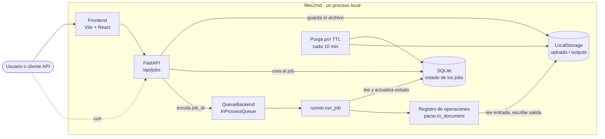
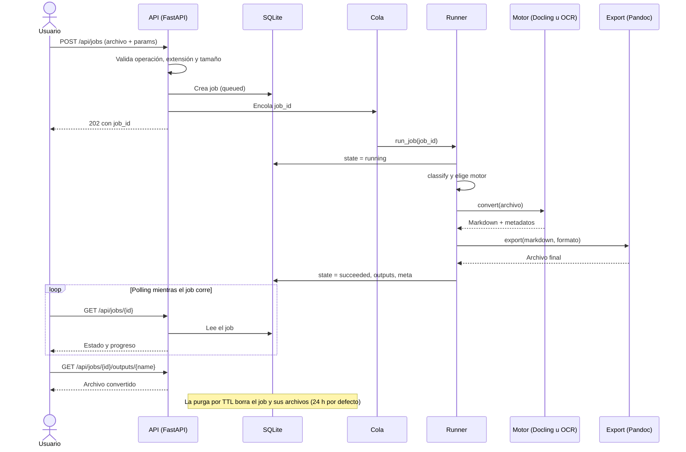
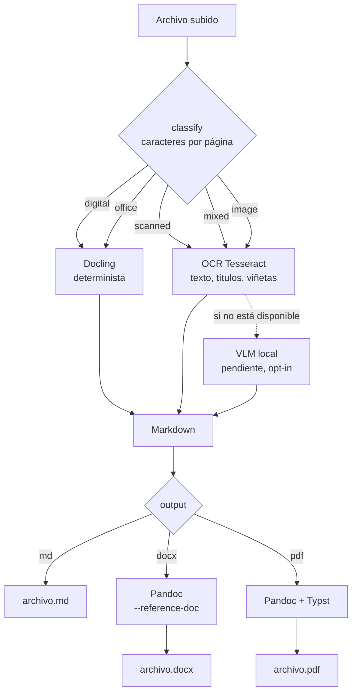

# Arquitectura

## Componentes

`QueueBackend` y `StorageBackend` son interfaces: en modo escalable se cambian por Redis/ARQ y S3/R2 sin tocar el resto.

## Flujo de un job

## Principios

1. **Todo es un job.** Subir → `job_id` → estado → outputs. OCR y modelos tardan de segundos a minutos; ningún
   endpoint bloquea esperando.
2. **Operaciones registradas.** `@operation("parse.xyz")`; validación de extensiones y `/api/operations` salen del
   registro. Una operación nueva (p. ej. `parse.to_json` con esquema) es un archivo.
3. **Interfaces para lo que cambia entre local y escalable:** `QueueBackend` y `StorageBackend`.
4. **Determinista primero.** Si el documento tiene capa de texto, no se usa OCR ni VLM: más rápido y sin alucinaciones.
5. **Degradación explícita.** Si un motor no está disponible, el job falla diciendo qué activar o qué perfil usar.
6. **Privacidad por defecto.** Bind a `127.0.0.1`, TTL de borrado (`FILES2MD_JOB_TTL_HOURS`), sin telemetría,
   motores externos apagados salvo opt-in.

## Por qué SQLite para los jobs

Persistencia sin servidor extra: un archivo, incluido en Python. Sobrevive reinicios y permite polling y purga por TTL.
Límite: un solo proceso de API. Para workers en varios contenedores se reemplaza `JobRepository` por Postgres.

## Pipeline

- `classify` mide caracteres extraíbles por página (`MIN_CHARS_PER_PAGE`, calibrable con el benchmark).
- `auto` sigue la tabla `PREFERENCE` de `pipeline.py`. Un PDF digital usa Docling y, si no está instalado,
  cae a OCR (queda registrado en `meta.engine_fallback_notes`).
- **OCR (Tesseract):** cada página se rasteriza a 300 dpi con `pypdfium2` y Tesseract devuelve cada palabra con
  su caja, bloque, párrafo, línea y confianza (formato TSV). Con eso se reconstruye el Markdown:
  - **Párrafos:** se respetan los bloques de Tesseract y se reparan palabras cortadas con guion al final de línea.
  - **Títulos:** línea con letra ≥ 1,3× la mediana de la página (`#` si ≥ 1,6×). Es una heurística: no
    detecta negritas del mismo tamaño y falla en páginas con muy pocas líneas.
  - **Viñetas:** Tesseract suele leer `•` como "e", "o" o "+". No se filtra por letra ("o" es una palabra en
    español), sino por geometría: un carácter suelto seguido de un hueco ≥ 0,8× la altura de la letra.
  - **Confianza:** media por página en `meta.ocr_page_conf`; las páginas con menos de 60 se listan en
    `meta.ocr_low_conf_pages` para revisarlas a mano.
  - **No soporta todavía:** tablas (salen como párrafos) y orden de lectura garantizado en varias columnas.
- **Formato personalizado:** plantillas de Word vía `--reference-doc` (pendiente exponerlo en la API).
- Post-proceso con LLM: **no incluido**. Si se añade, opt-in y con diff visible (riesgo de "corregir" cifras).

## Interfaz web

Pensada para una persona que solo quiere subir un archivo y recibir el resultado:

1. **Subir:** zona de arrastre; valida extensión y tamaño en el navegador antes de enviar.
2. **Elegir formato:** tarjetas Markdown / Word / PDF. `GET /api/capabilities` dice qué formatos y motores
   existen en esta instalación; lo que falta se muestra deshabilitado con el motivo, en vez de fallar después.
   El motor queda en "Opciones avanzadas" (por defecto, automático).
3. **Progreso:** `meta.stage` (`analyzing` → `reading` → `exporting` → `done`) y `meta.page`/`page_total`
   se traducen a frases ("Leyendo el texto · página 2 de 5"). La animación de escaneo es la firma visual.
4. **Resultado:** original (renderizado en el navegador, sin volver a pedirlo al servidor) y resultado lado
   a lado. El `.md` se entrega siempre, aunque se pida Word o PDF, porque alimenta la vista previa.

Seguridad: el Markdown se convierte a HTML con `marked` y se sanitiza con DOMPurify antes de mostrarse,
porque proviene de un documento subido. Las fuentes van empaquetadas (no Google Fonts) para no hacer
peticiones externas.

## Contrato del job

| Campo | Significado |
|---|---|
| `operation` | `parse.to_document` |
| `params` | `engine`: `auto\|docling\|ocr\|vlm` · `output`: `md\|docx\|pdf` |
| `state` | `queued → running → succeeded \| failed \| cancelled` |
| `meta` | `stage`, `page`, `page_total`, `input_kind`, `pages`, `engine`, `engine_fallback_notes`, `elapsed_s`; con OCR además `ocr_mean_conf`, `ocr_page_conf`, `ocr_low_conf_pages`, `ocr_langs`, `ocr_dpi` |

## Estado de implementación

| Pieza | Estado |
|---|---|
| Núcleo (jobs, cola local, storage, API, TTL, token opcional) | Implementado y probado |
| Clasificador digital/escaneado | Implementado y probado |
| Flujo completo con motor simulado → `.md` | Probado |
| Motor Docling real | Implementado, **sin probar** |
| Export docx/pdf (Pandoc + Typst) | Implementado, **sin probar**; falta instalar Typst en la imagen |
| Motor OCR (Tesseract) | Implementado y probado con OCR real sobre documentos sintéticos; **sin probar con escaneos reales** |
| Motor VLM | Esqueleto (`NotImplementedError`) |
| Plantillas Word personalizadas | No expuesto |
| `RedisQueue` | Esqueleto |
| Benchmark | Métricas CER/WER, generador sintético y runner implementados; **falta dataset real** |

## Decisiones

- **Licencia MIT.** No se usa PyMuPDF (AGPL) ni Marker/Surya (restricciones comerciales).
- **Motor OCR:** se decide con el benchmark, no por intuición.
